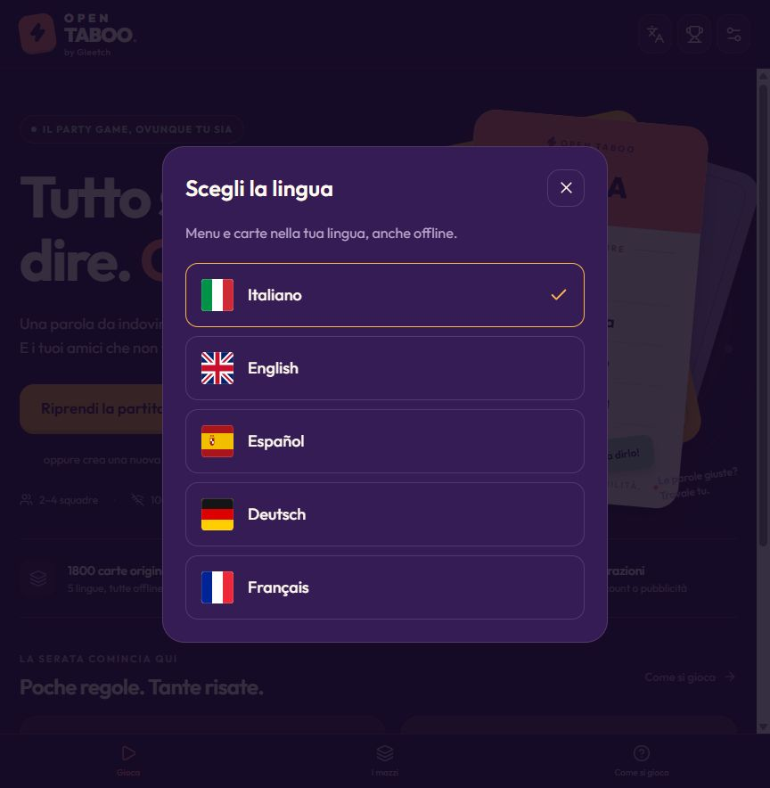

# Open Taboo

**Think. Talk. Dare.**

An offline Android party game inspired by Taboo, featuring **5 languages**, **1,800 cards per language**, and **2–4 teams**. Built with Expo, React Native, and TypeScript.

An independent project by **Gleetch**.

<p align="center">
  
  
</p>

## Install on Android

1. Download the `.apk` file provided in this repository to your Android phone.
2. Open the downloaded file and follow the Android installation prompts.
3. Launch **Open Taboo** and start playing.

The APK runs on its own: no Expo Go, account, or computer is required. After installation, the game works offline.

To keep your saved matches and preferences when updating, install the new APK over the existing app and choose **Update** when prompted. Keep the current app installed.

## Features

- **Play offline:** cards, translations, fonts, icons, and sound effects are bundled with the app.
- **2–4 teams:** customize team names and play together on one phone.
- **Five languages:** Italian, English, Spanish, German, and French for menus, rules, decks, and cards.
- **1,800 cards in each language:** six mixable decks with 300 cards each. Every card has one target word and five forbidden words.
- **Configurable matches:** choose the timer, number of rounds, penalties, and skip limit.
- **Turn review:** correct card outcomes before confirming the score.
- **Local progress:** resume a saved match and browse the last 20 completed games.
- **Pause and resume:** the timer pauses when the app goes into the background, and the card stays hidden until play resumes.
- **Animated interface:** purple, coral, and orange styling, rounded cards, local sound effects, and optional haptic feedback.
- **No account, ads, tracking, or gameplay server.**

## How to play

1. Create two, three, or four teams and choose your decks and match settings.
2. Pass the phone to the clue-giver. An opponent checks the forbidden words.
3. Describe the target word without saying it or any of its five forbidden words. No word fragments, translations, gestures, or rhyming clues.
4. Tap **Got it!** for a correct answer, **Taboo!** for a forbidden word, or **Skip** to move on.
5. When the timer ends, review the results and confirm the turn. Pass the phone to the next team.

Each team plays once per round. The highest score wins after the final round; tied teams share the victory.

| Setting        | Available options              |
| -------------- | ------------------------------ |
| Teams          | 2, 3, or 4                     |
| Time per turn  | 30, 45, 60, 90, or 120 seconds |
| Rounds         | 1, 3, 5, or 7                  |
| Correct answer | +1 point                       |
| Taboo penalty  | 0, −1, or −2 points            |
| Skips per turn | 0, 3, 5, or unlimited          |
| Skip penalty   | 0 or −1 point                  |

Scores can be negative. Cards are shuffled and do not repeat until the selected deck pool is exhausted. An unresolved card at the end of a turn is discarded without a penalty before the next team plays.

## Languages and decks

The first launch uses the device language, including regional variants such as `fr-CA`. Unsupported languages fall back to **English**. A manually selected language is saved locally and takes priority on later launches.

Tap the **flag button to the left of the trophy** to change language. The button shows the active language's flag. Changing language during a live turn pauses the timer and hides the card; team names, scores, and match progress are preserved.

| Deck                  | Cards per language |
| --------------------- | -----------------: |
| The classics          |                300 |
| Everyday life         |                300 |
| A wild world          |                300 |
| Lights, camera, play! |                300 |
| Around the world      |                300 |
| Outside the box       |                300 |
| **Total**             |          **1,800** |

The five languages provide **9,000 localized card versions** of the same 1,800 base cards. Translations were prepared using local models and editorial corrections; specialized vocabulary may benefit from further language review.

## Run the source (optional)

### Requirements

- Node.js **22.13+ on the 22.x release line**, **24.3+ on the 24.x release line**, or **26+**.
- npm.
- For Android development: a compatible Expo Go client or an Android emulator/development build.

### Install and run

From the project directory:

```sh
npm ci
npm start
```

- **Android:** scan the QR code with an Expo Go version compatible with **SDK 58**, or press `a` with an Android emulator running. The phone must be able to reach the Metro development server.
- **Web:** press `w`, or run `npm run web`.
- **Different development port:** run `npm start -- --port 8082`.

If your installed Expo Go version does not support SDK 58, use a compatible client from [expo.dev/go](https://expo.dev/go). To play without a development environment, install the APK provided in this repository.

On Windows PowerShell, use `npm.cmd` or `npx.cmd` if script execution policy prevents running the corresponding `.ps1` wrappers.

### Preview the production web build

```sh
npm run export:web
npm run preview
```

Open [localhost:4173](http://localhost:4173). The [phone preview](http://localhost:4173/__mobile) displays the app in a 390-pixel-wide frame. The preview server listens only on the local machine.

## Offline behavior and privacy

An installed Android APK works offline from its first launch. The app does not download card packs, call translation services, or require a gameplay backend. Preferences, the current match, and match history are stored on the device using AsyncStorage.

The app does not record speech or require microphone access. Another player checks the forbidden words. The Android configuration also excludes overlay and external-storage permissions.

Development with Expo Go still requires access to the Metro server. The web version is a functional preview and does not include a service worker for offline cold starts.

## Development and checks

| Command                | Purpose                                             |
| ---------------------- | --------------------------------------------------- |
| `npm start`            | Start the Expo development server                   |
| `npm run android`      | Start Expo for Android development                  |
| `npm run web`          | Start the web development preview                   |
| `npm run typecheck`    | Check TypeScript types                              |
| `npm test`             | Run the game engine and localization tests          |
| `npm run cards:check`  | Check the Italian card expansion files              |
| `npm run export:web`   | Generate the production web build                   |
| `npm run preview`      | Serve the exported web build locally                |
| `npm run format`       | Format source files and documentation               |
| `npm run format:check` | Check formatting                                    |
| `npm run assets`       | Regenerate the included app icons and sound effects |

The 24 automated tests cover scoring, skip limits, turn order, equal turns for all team counts, end-of-match behavior, saved-game recovery, device-language fallback, message interpolation, and card integrity across all five languages. Saved games from the original 40-card decks are expanded without losing the current card or progress.

## Project structure

```text
App.tsx                       Navigation, timer, app lifecycle, and match coordination
src/
  components/                 Shared UI, animated cards, and vector language flags
  screens/                    Home, decks, rules, setup, match, and results
  game/engine.ts              Pure game logic and saved-game recovery
  data/cards.ts               Deck metadata and base Italian cards
  data/expansion/             Additional Italian cards for each deck
  data/locales/               Bundled English, Spanish, German, and French cards
  data/localizedCards.ts      Card lookup with stable IDs across languages
  i18n/                       Interface translations and language preference
  hooks/useFeedback.ts        Local audio and haptic feedback
  storage.ts                  Local persistence
  theme.ts                    Colors and typography
assets/                       App icons and five WAV sound effects
scripts/                      Asset generation, card checks, and preview server
tests/                        Game engine and localization tests
docs/                         Screenshots, validation notes, and translation guide
app.json                      Expo configuration and Android permissions
```

## Customize cards and translations

The first 40 Italian cards of each deck are in `src/data/cards.ts`; the remaining 260 are in `src/data/expansion/`. Each row contains the target word followed by exactly five forbidden words:

```text
Pizza|Forno|Mozzarella|Pomodoro|Margherita|Napoli
```

Other languages use JSON files in `src/data/locales/`. Each card ID maps to an array containing the target word and its five forbidden words. Keep IDs stable because saved matches use them. When adding cards, update all language files and the expected counts in the tests.

Interface text lives in `src/i18n/messages.ts`, with columns for Italian, English, Spanish, German, and French. Dynamic values use placeholders such as `{{0}}`.

See the [translation guide](docs/TRANSLATIONS.md) and [validation notes](docs/VALIDATION.md) for more implementation details. These supporting documents are currently in Italian.

## Contributing

Bug reports, language corrections, and card improvements are welcome. For translation changes, include the language and card ID. Before submitting a code or data change, run:

```sh
npm run typecheck
npm test
npm run cards:check
npm run format:check
```

## Credits and licensing

Created by **Gleetch**. Built with Expo, React Native, React, and TypeScript. The interface uses **Outfit** fonts and **Lucide** icons; fonts, dependencies, and other third-party components retain their respective licenses. See [third-party notices](THIRD_PARTY_NOTICES.md).

This repository does not currently include a project-wide `LICENSE` file. A project license should be added before offering the original code under specific open-source terms.

Open Taboo is an independent project inspired by the word game Taboo and the [Marmalade Game Studio app](https://play.google.com/store/apps/details?id=com.marmalade.taboo). It is not affiliated with or endorsed by Hasbro or Marmalade Game Studio. The project does not include logos, screenshots, sounds, or card databases extracted from the official app. Third-party trademarks remain the property of their respective owners.
